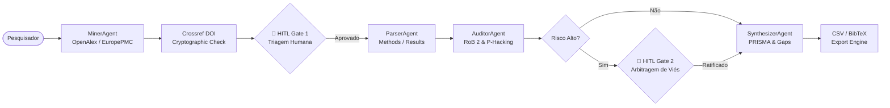

# 🔬 CortexLab / SciLab Agents
### Human Augmentation in Scientific Research & Systematic Reviews
> **Uma plataforma multi-agente de rigor acadêmico e nível comercial para amplificação cognitiva do pesquisador científico.**

[](LICENSE)
[](https://www.python.org/)
[](https://nextjs.org/)
[](https://github.com/langchain-ai/langgraph)
[](#-arquitetura-100-zero-cost)
[](http://www.prisma-statement.org/)
[](#-roadmap-de-12-semanas-residência-em-ia)

---

## 🌟 O que é o CortexLab?

O **CortexLab** é uma plataforma de **Human Augmentation** projetada para transformar a maneira como pesquisadores, pós-graduandos e laboratórios conduzem **Revisões Sistemáticas de Literatura** e **Auditorias Metodológicas**.

Diferente de chatbots genéricos que resumem textos superficialmente e inventam citações, o CortexLab combina:
1. **Motor Multi-Agente Científico (Python, FastAPI, LangGraph):** Minera APIs públicas abertas (OpenAlex, Europe PMC, Semantic Scholar, arXiv), valida DOIs criptograficamente na Crossref, disseca seções de métodos/resultados e audita rigor estatístico (p-hacking, $N$ amostral, risco de viés RoB 2).
2. **Interface Espacial HD-2D (Next.js, Tailwind CSS, Framer Motion):** Um laboratório virtual isométrico onde o pesquisador visualiza cada agente trabalhando em sua bancada temática, acompanhado de condutos de dados luminosos e um HUD em glassmorphism.
3. **Supervisão Humana Soberana (Human-in-the-Loop):** Checkpoints no grafo onde a IA é obrigada a parar para receber o crivo do pesquisador em etapas críticas de triagem e arbitragem de viés.
4. **Arquitetura 100% Gratuita (Zero-Cost):** Projetada para rodar integralmente nas cotas gratuitas do Google Gemini, Groq Cloud, Supabase, Hugging Face Spaces e Vercel, com suporte a BYOK (Bring Your Own Key).

---

## ⚖️ Por que Human Augmentation e não "IA Autônoma"?

| Critério Científico | Processo Manual Tradicional | Chatbots Genéricos (ChatGPT / Claude) | **CortexLab (Human Augmentation)** |
| :--- | :--- | :--- | :--- |
| **Tempo de Triagem** | Semanas ou meses de leitura | Minutos (mas não confiável) | **Redução de ~65% com rigor mantido** |
| **Alucinação de DOIs** | 0% (leitura direta) | **Alta (inventa artigos e fontes)** | **0.00% (Validação Crossref mandatória)** |
| **Rastreabilidade** | Notas em planilhas / papel | Afirmações soltas sem parágrafo | **Link direto com citação literal (verbatim)** |
| **Auditoria Metodológica** | Exaustiva (cálculo de poder, RoB 2) | Ignorada ou muito rasa | **Agente Auditor com checklists formais** |
| **Governança Humana** | 100% manual | Nenhuma (caixa preta) | **LangGraph HITL Checkpoints programáticos** |
| **Padrão de Saída** | Preenchimento manual no Excel | Texto solto não estruturado | **Matriz PRISMA 2020 + BibTeX exportável** |

---

## 🏛️ Arquitetura Multi-Agente (LangGraph Engine)

O fluxo de raciocínio é orquestrado por um grafo cíclico de estados com persistência de checkpoints:



### Bancadas Especializadas no Laboratório Virtual
- 🔍 **Bancada de Mineração (`MinerAgent`):** Executa queries federadas, elimina duplicatas e valida se o DOI existe na Crossref antes de incluir no fluxo.
- 📄 **Bancada de Segmentação (`ParserAgent`):** Divide PDFs científicos em blocos canônicos (*Methods*, *Results*, *Limitations*) com hashes de integridade por parágrafo.
- 🛡️ **Bancada de Auditoria (`AuditorAgent`):** Avalia risco de viés de acordo com o RoB 2 / STROBE, verifica p-valores limítrofes e ausência de cálculo de poder estatístico a priori.
- 🧬 **Bancada de Síntese (`SynthesizerAgent`):** Preenche a Matriz PRISMA 2020 e cruza limitações para inferir **Knowledge Gaps** e sugerir hipóteses para futuras pesquisas.
- 🛑 **Estação do Pesquisador (HITL Station):** Onde o cientista assume o controle, inspeciona artigos sinalizados e comanda a retomada do grafo.

---

## 🎨 Camada Visual: Estética HD-2D & Spatial HUD

A interface une o poder analítico de um dashboard científico com a imersão de um laboratório de ficção científica (HD-2D Sci-Fi Lab):
- **Paleta Cyberpunk Científica:** Fundo profundo em `Slate-950`, dados ativos em `Cyan-400`, validações em `Emerald-400` e alertas de HITL/viés em `Amber-500` / `Rose-500`.
- **`AgentStatusBadge`:** Badges flutuantes sobre as bancadas com pulso luminoso em tempo real (`MINERANDO ARTIGOS`, `AGUARDANDO APROVAÇÃO`).
- **`DataConduitLines`:** Linhas ortogonais no piso que brilham e disparam partículas quando um agente transmite seu pacote de dados ao próximo.
- **`ControlBoardHUD`:** Console em glassmorphism no canto inferior direito com telemetria contínua, status do LangGraph e botão de ação imediata para o checkpoint humano.

---

## 💰 Arquitetura 100% Zero-Cost

O projeto foi intencionalmente arquitetado para permitir que qualquer pesquisador, laboratório universitário ou bolsista opere sem custos de infraestrutura:

| Componente | Provedor Gratuito | Cota / Benefício | Suporte a BYOK |
| :--- | :--- | :--- | :--- |
| **LLM Primário** | **Google Gemini Free Tier** | 15 RPM / 1M TPM (`gemini-1.5-flash`) | Sim (chave no browser) |
| **LLM Secundário** | **Groq Cloud Free Tier** | 30 RPM (`llama-3.3-70b-versatile`) | Sim |
| **Backend API** | **Hugging Face Spaces** | Docker Container gratuito (Porta 7860) | Deploy contínuo |
| **Frontend Web** | **Vercel Free Tier** | Hospedagem global Edge Next.js | Sim |
| **Banco de Dados** | **Supabase Free Tier** | PostgreSQL + `pgvector` (500MB gratuitos) | Sim |
| **APIs Científicas** | **OpenAlex, Europe PMC, arXiv** | 100% públicas, abertas e gratuitas | N/A |

---

## 📅 Roadmap de 12 Semanas (Residência em IA)

```
[Semana 01-02] ──▶ Discovery (The Mom Test) & Especificação de Requisitos
[Semana 03-04] ──▶ Ingestão Federada (OpenAlex/EuropePMC) & Validador Crossref
[Semana 05-06] ──▶ Parser Científico & Auditor Metodológico (RoB 2)
[Semana 07-08] ──▶ Interface Espacial HD-2D & Glassmorphic HUD (Next.js)
[Semana 09-10] ──▶ Grafo LangGraph com Human-in-the-Loop & Exportação PRISMA
[Semana 11-12] ──▶ Validação Empírica (N=20) & Redação do Artigo Científico
```

- **Semana 01-02 (Fase Atual):** Entrevistas em profundidade com pesquisadores acadêmicos (`docs/01-discovery/`), engenharia de requisitos (`docs/02-requirements/`), modelagem C4 (`docs/03-architecture/`) e métricas empíricas (`docs/04-validation/`).
- **Semana 03-04:** Conexão assíncrona com OpenAlex e Europe PMC, fila de download de PDFs Open Access e algoritmo de hash de integridade de parágrafos.
- **Semana 05-06:** Implementação do `AuditorAgent` com prompts estruturados para cálculo de poder amostral, p-hacking e pontuação de viés.
- **Semana 07-08:** Refinamento dos shaders WebGL / Canvas isométrico, animação dos condutos de dados e responsividade cross-device.
- **Semana 09-10:** Checkpoint persistente no PostgreSQL via Supabase e suporte a streaming de telemetria via Server-Sent Events (SSE).
- **Semana 11-12:** Aplicação do benchmark empírico com 20 pesquisadores (redução de tempo, Cohen's Kappa, SUS Score) e entrega da monografia de conclusão da Residência.

---

## 🚀 Como Executar Localmente

### Pré-requisitos
- **Node.js** >= 18.0
- **Python** >= 3.11
- Git

### 1. Clonar o Repositório
```bash
git clone https://github.com/samucabsb/cortex-lab.git
cd cortex-lab
```

### 2. Configurar e Rodar o Backend
```bash
cd backend
cp .env.example .env

# Criar ambiente virtual
python -m venv .venv
source .venv/bin/activate  # No Windows: .venv\Scripts\activate

# Instalar dependências
pip install -r requirements.txt

# Executar servidor FastAPI (porta 7860 padrão HF Spaces)
uvicorn app.main:app --reload --host 0.0.0.0 --port 7860
```
> O backend estará acessível em `http://localhost:7860` com documentação interativa OpenAPI em `http://localhost:7860/docs`.

### 3. Configurar e Rodar o Frontend
```bash
cd ../frontend
cp .env.example .env.local

# Instalar dependências
npm install

# Iniciar servidor Next.js
npm run dev
```
> A interface estará rodando em `http://localhost:3000`.

---

## 📂 Estrutura do Monorepo

```
cortex-lab/
├── .github/
│   └── workflows/
│       ├── ci.yml                 # Testes de backend e build do frontend
│       └── deploy-hf-space.yml    # Sincronização contínua com Hugging Face Spaces
├── docs/
│   ├── 01-discovery/
│   │   ├── interview-script.md    # Roteiro The Mom Test para entrevistas científicas
│   │   └── interview-template.md  # Template padronizado de registro de entrevista
│   ├── 02-requirements/
│   │   └── functional-reqs.md     # Requisitos Funcionais e Não-Funcionais (SRS)
│   ├── 03-architecture/
│   │   └── c4-diagrams.md         # Diagramas C4 e Máquina de Estados LangGraph
│   └── 04-validation/
│       └── empirical-metrics.md   # Protocolo de validação experimental da Residência
├── backend/
│   ├── app/
│   │   ├── agents/
│   │   │   └── graph.py           # Grafo de estados LangGraph com nós HITL
│   │   ├── api/v1/
│   │   │   └── router.py          # Rotas REST e streaming SSE
│   │   ├── core/
│   │   │   ├── config.py          # Configurações Pydantic
│   │   │   └── llm_provider.py    # Resiliência Gemini / Groq com BYOK
│   │   ├── models/
│   │   │   └── schemas.py         # Schemas de dados científicos
│   │   ├── services/
│   │   │   ├── open_apis.py       # OpenAlex, Europe PMC e Crossref
│   │   │   └── pdf_parser.py      # Segmentação de seções (Methods, Results)
│   │   └── main.py                # FastAPI entrypoint
│   ├── tests/
│   │   └── test_api.py            # Testes automatizados Pytest
│   ├── Dockerfile                 # Contêiner para Hugging Face Spaces (Porta 7860)
│   └── requirements.txt
├── frontend/
│   ├── src/
│   │   ├── app/
│   │   │   ├── globals.css        # Estilos globais e tema Dark Sci-Fi
│   │   │   ├── layout.tsx         # Layout com metadados SEO
│   │   │   └── page.tsx           # Aplicação principal integrada
│   │   ├── components/
│   │   │   ├── spatial/
│   │   │   │   ├── AgentStatusBadge.tsx   # Badges luminosos flutuantes
│   │   │   │   ├── DataConduitLines.tsx   # Condutos de dados animados no piso
│   │   │   │   ├── ControlBoardHUD.tsx    # HUD glassmorphic em tempo real
│   │   │   │   └── IsometricLabCanvas.tsx # Laboratório virtual HD-2D
│   │   │   ├── dashboard/
│   │   │   │   ├── PrismaMatrixTable.tsx  # Matriz de síntese sistemática
│   │   │   │   ├── KnowledgeGapsCard.tsx  # Card de lacunas de conhecimento
│   │   │   │   └── ExportToolbar.tsx      # Exportação CSV e BibTeX
│   │   │   └── hitl/
│   │   │       └── HumanApprovalModal.tsx # Modal de aprovação do pesquisador
│   │   ├── lib/
│   │   │   └── api.ts             # Cliente de comunicação com fallback offline
│   │   └── types/
│   │       └── index.ts           # Definições TypeScript
│   ├── package.json
│   └── tailwind.config.ts
├── .gitignore
└── README.md
```

---

## 📜 Citação Científica & Licença

Se você utilizar o CortexLab em sua pesquisa ou projeto acadêmico, por favor cite:

```bibtex
@software{cortexlab2026,
  author = {Oliveira, Samuel and Colaboradores da Residência em IA},
  title = {CortexLab: Human Augmentation in Scientific Research via Specialized Multi-Agent Networks},
  year = {2026},
  url = {https://github.com/samucabsb/cortex-lab}
}
```

Distribuído sob a licença **MIT**. Veja `LICENSE` para mais informações.
